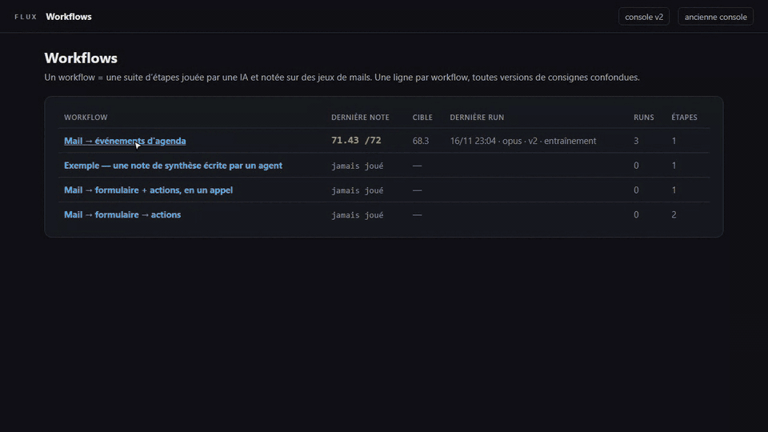
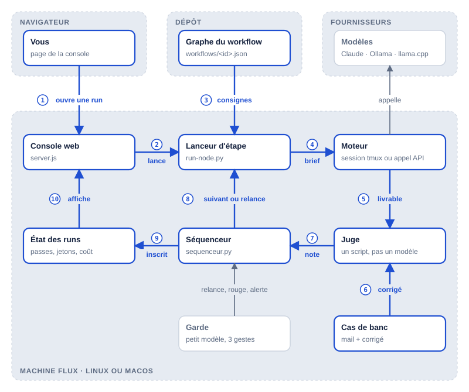

[English](README.md) · **Français**

# flux

**Joue une chaîne d'agents d'IA étape par étape et note chaque étape par un script, pour garder le plus petit modèle qui fait encore le travail.**

[](https://drive.google.com/file/d/19VzTHBvsJCijUQQzpf5rDuJZf5ZfLpIr/view)

*Trois modèles notés sur sept mails inventés, puis un mail neuf traité en direct. [Vidéo complète (1:14)](https://drive.google.com/file/d/19VzTHBvsJCijUQQzpf5rDuJZf5ZfLpIr/view)*

## Ce qu'on fait avec

- **Graphe.** Un workflow est un fichier JSON. Chaque étape nomme son entrée, ses livrables, son modèle et son juge ; le vérificateur de graphes refuse une étape sans eux.
- **Deux moteurs.** Une session Claude Code dans `tmux` pour les étapes d'agent, visible en direct dans la console. Ou un appel direct à un modèle, tenu par un schéma JSON : Claude par `claude -p`, Ollama ou llama.cpp.
- **Banc.** Des cas inventés avec leur corrigé ; un script, jamais un modèle, note chaque passe. Exemple : un fil de mails changé en événements d'agenda, noté sur 72 points. En production, pas de note : valider le résultat dans la console en fait un nouveau cas.
- **Pilote automatique.** Vert : étape suivante. Rouge, session morte ou mur de quota : relance, puis run bloquée et alerte. Une garde facultative, un petit modèle, ne peut que relancer, marquer rouge ou alerter.
- **Descente de modèles.** Un lot de cas joué sur plusieurs modèles côte à côte ; on garde le plus petit qui atteint la cible.
- **Console.** Chaque passe avec son entrée, sa sortie, sa durée, ses jetons, son coût et sa note.

## Architecture



## État

- **En service** sur un serveur privé depuis août 2026. Il fait tourner la chaîne de construction d'applis web et la chaîne de veille, dans leurs propres dépôts privés.
- **Ce dépôt** est la version libre, publiée le 26/10/2026. 153 tests passent hors ligne (`FLUX_SANS_RESEAU=1`).
- **Langue.** Commentaires du code et textes de la console en français.

## Le lancer

```bash
git clone https://github.com/anthohunt/flux && cd flux
python3 -m pip install -r requirements.txt
cp moteurs.example.json moteurs.json && export FLUX_MOTEURS=$PWD/moteurs.json
python3 runtime/verifier-graphes.py        # GRAPHES CONFORMES
node runtime/server.js                     # console sur http://127.0.0.1:8901
python3 tools/jouer-lot.py agenda --lot boucle --modeles sonnet,haiku --nom essai
```

<details><summary>Prérequis, réglages, écrire un workflow</summary>

- Linux ou macOS, Python 3.10+, Node.js 18+, `tmux`, `git`. [Claude Code](https://code.claude.com/docs/en/overview) installé et connecté pour les modèles Claude (produit distinct, sous les conditions d'Anthropic) ; en option : Ollama ou llama.cpp pour les modèles locaux, ttyd pour le terminal en direct.
- La console n'a pas d'authentification et écoute en local ; ne l'ouvrir au réseau (`FLUX_HOTE=0.0.0.0`) que derrière un réseau privé ou un proxy authentifié. Tous les réglages : [`.env.example`](.env.example).
- Un workflow : `workflows/<id>.json` (contrat : `runtime/workflow.schema.json` ; squelette : `tools/nouvelle-pipeline.py <id> "<Titre>"`). Un cas de banc : `cas/<id>/` avec l'entrée et son corrigé, déclaré dans `cas/cas.json`.
- Plus : [docs/architecture.md](docs/architecture.md) (une run, la notation, la descente de modèles) et [docs/interface.md](docs/interface.md) (brancher une chaîne sur flux), en anglais.

</details>

## Licences

Code : [Apache 2.0](LICENSE) ([NOTICE](NOTICE)). Documentation et cas inventés de `cas/` : [CC BY 4.0](LICENSE-docs). xterm.js 5.5.0 : MIT.

---

**Anthony Hunt** · [ingevision.cloud](https://ingevision.cloud/?p=flux) · [LinkedIn](https://www.linkedin.com/in/anthony-hunt-3948a9196) · [GitHub](https://github.com/anthohunt)
