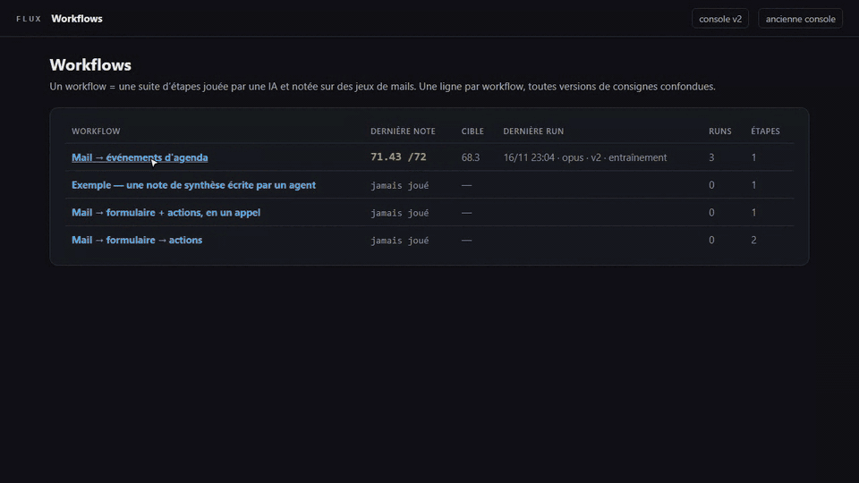
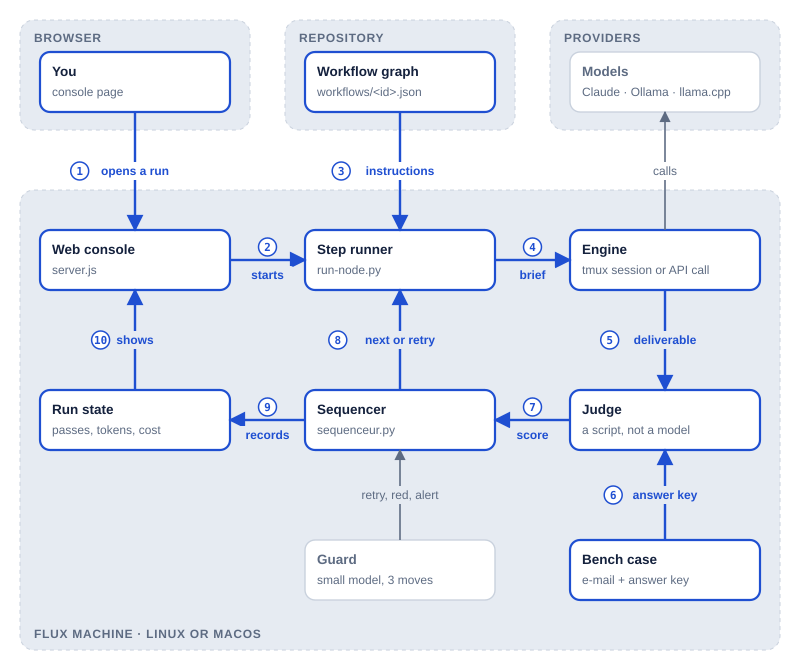

**English** · [Français](README.fr.md)

# flux

**Plays a pipeline of AI agents step by step and scores every step with a script, to keep the smallest model that still does the job.**

[](https://drive.google.com/file/d/19VzTHBvsJCijUQQzpf5rDuJZf5ZfLpIr/view)

*Three models scored on seven invented e-mails, then a new e-mail processed live. [Full video (1:14)](https://drive.google.com/file/d/19VzTHBvsJCijUQQzpf5rDuJZf5ZfLpIr/view)*

## Using it

- **Graph.** A workflow is a JSON file. Each step names its input, its deliverables, its model and its judge; the graph checker refuses a step without them.
- **Two engines.** A Claude Code session in `tmux` for agent steps, shown live in the console. Or one direct model call bound to a JSON schema: Claude through `claude -p`, Ollama or llama.cpp.
- **Bench.** Invented cases with an answer key; a script, never a model, scores each pass. Example: an e-mail thread turned into calendar events, scored on 72 points. In production there is no score: validating the result in the console saves it as a new case.
- **Autopilot.** Green: next step. Red, dead session or quota wall: retry, then blocked and an alert. An optional small guard model can only retry, mark red or alert.
- **Model descent.** One lot of cases played on several models side by side; the smallest model that reaches the target is kept.
- **Console.** Every pass with its input, output, time, tokens, cost and score.

## Architecture



## Status

- **In service** on a private server since August 2026. It runs the web-app building pipeline and the research-watch pipeline, kept in their own private repositories.
- **This repository** is the open-source version, published on 26/10/2026. 153 tests pass offline (`FLUX_SANS_RESEAU=1`).
- **Language.** Code comments and console text are in French.

## Run it

```bash
git clone https://github.com/anthohunt/flux && cd flux
python3 -m pip install -r requirements.txt
cp moteurs.example.json moteurs.json && export FLUX_MOTEURS=$PWD/moteurs.json
python3 runtime/verifier-graphes.py        # GRAPHES CONFORMES
node runtime/server.js                     # console on http://127.0.0.1:8901
python3 tools/jouer-lot.py agenda --lot boucle --modeles sonnet,haiku --nom essai
```

<details><summary>Requirements, settings, writing a workflow</summary>

- Linux or macOS, Python 3.10+, Node.js 18+, `tmux`, `git`. [Claude Code](https://code.claude.com/docs/en/overview) installed and logged in for Claude models (a separate product, under Anthropic's terms); optional: Ollama or llama.cpp for local models, ttyd for the live terminal.
- The console has no authentication and listens on localhost; open it to a network (`FLUX_HOTE=0.0.0.0`) only behind a private network or an authenticated proxy. All settings: [`.env.example`](.env.example).
- A workflow: `workflows/<id>.json` (contract: `runtime/workflow.schema.json`; scaffold: `tools/nouvelle-pipeline.py <id> "<Title>"`). A bench case: `cas/<id>/` with the input and its answer key, declared in `cas/cas.json`.
- More: [docs/architecture.md](docs/architecture.md) (a run, scoring, model descent) and [docs/interface.md](docs/interface.md) (plugging a pipeline into flux).

</details>

## Licenses

Code: [Apache 2.0](LICENSE) ([NOTICE](NOTICE)). Documentation and the invented cases in `cas/`: [CC BY 4.0](LICENSE-docs). xterm.js 5.5.0: MIT.

---

**Anthony Hunt** · [ingevision.cloud](https://ingevision.cloud/?lang=en&p=flux) · [LinkedIn](https://www.linkedin.com/in/anthony-hunt-3948a9196) · [GitHub](https://github.com/anthohunt)
